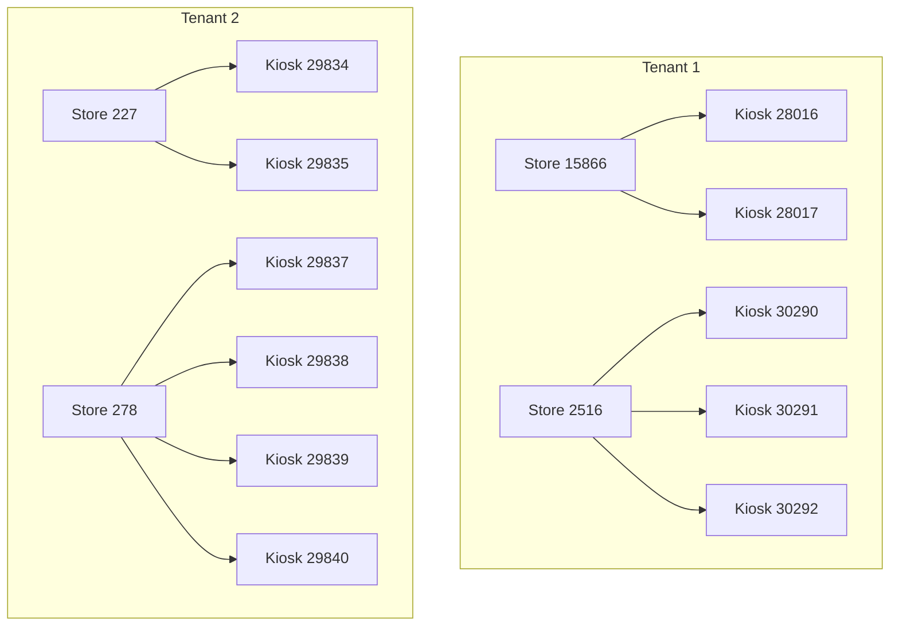
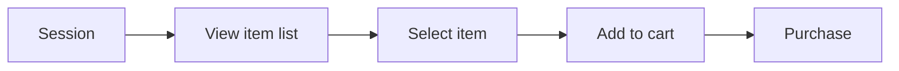
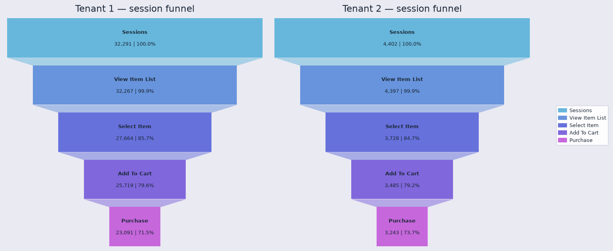
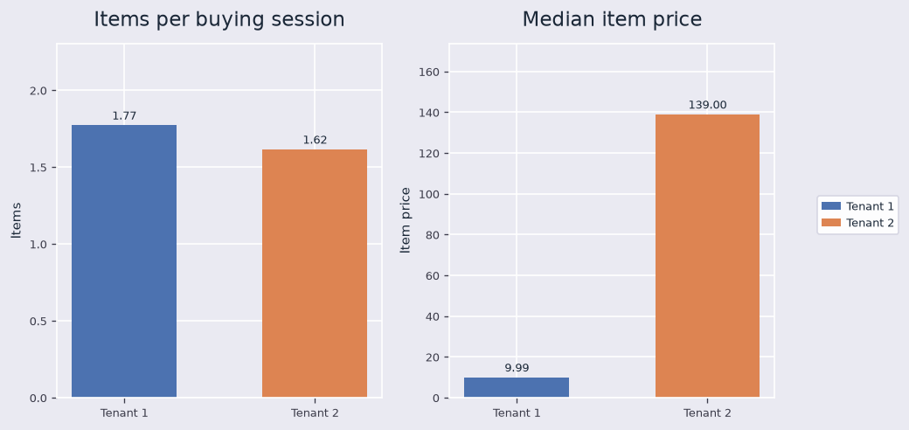
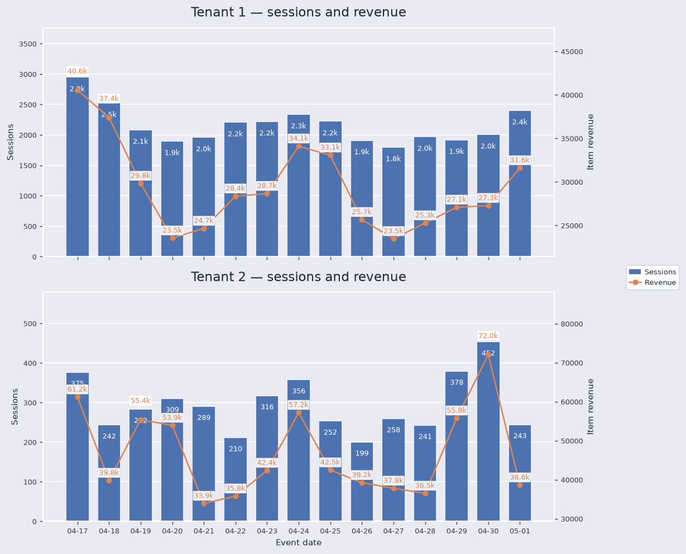
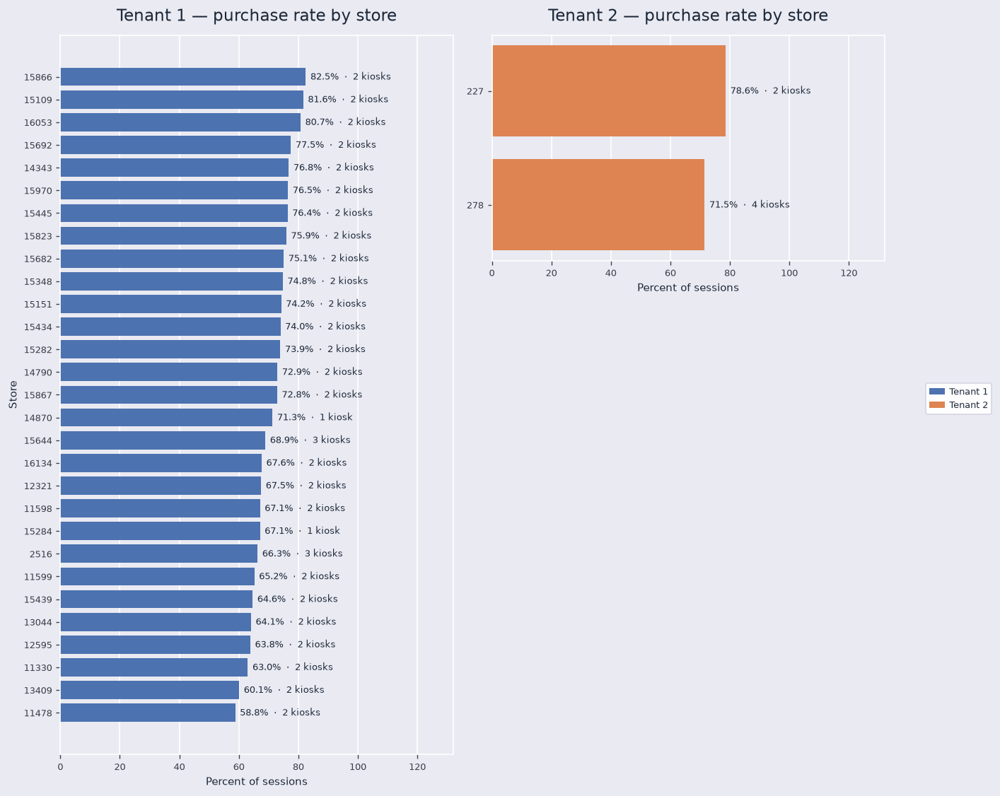

# Kiosk session analysis

## What this dataset is

This is a payment-operations log for self-serve kiosks. Tenants run stores. Stores run kiosks. A guest or customer walks up to a kiosk, starts a session, and moves through the order steps. Some stores take more steps (or more time) to finish than others. The start of the path is the session. The end of a completed path is a purchase.

## Journey

Tenant owns stores. Store owns kiosks. A session lives on one kiosk.

- **Tenant 1** has 29 stores, so the map only shows two.
- **Tenant 2** has both of its stores.




Intended path on the kiosk looks like this. The funnel still counts a step if that event shows up at least once, even if the guest skipped around.




The notebook is [`notebooks/kiosk_sessions_operations_analysis.ipynb`](notebooks/kiosk_sessions_operations_analysis.ipynb). The SQL under `data/sql/` is what it runs. Saved outputs were generated from the repo root.

## Findings you can act on

Same visit grain as the notebook. Conversion is also `conversion_by_tenant` in `data/sql/metric_layer.sql`. The denominator is all visits for that tenant, or all visits at that store or kiosk.

### Conversion

Purchase conversion = visits with at least one purchase ÷ all visits.

| Tenant | Sessions | Purchased | Purchase conversion |
| --- | ---: | ---: | ---: |
| Tenant 1 | 32,291 | 23,091 | 71.5% |
| Tenant 2 | 4,402 | 3,243 | 73.7% |

The brands already convert at nearly the same rate. Track this rate, then look at the step they drop and the store they stand in. Do not switch the base to visits that opened the menu.

### Churn

Customer churn cannot be measured here. There is no guest id, and the log is about 15 days. You cannot see a person leave the brand.

The substitute is a visit that reached the cart and never paid, divided by visits that reached the cart.

| Tenant | Reached cart | Cart, no purchase | Cart abandon rate |
| --- | ---: | ---: | ---: |
| Tenant 1 | 25,719 | 2,640 | 10.3% |
| Tenant 2 | 3,485 | 255 | 7.3% |

That is a guest walking away from a cart, not a customer who stopped coming back. Tenant 1 loses more of those carts. The experiment below is built on that gap.

### Segmentation

RFM and LTV need a person you can see again. This file has visits, not people. The split someone can act on is what the visit did.

| Segment | What the visit did | Tenant 1 | Tenant 2 | What to do |
| --- | --- | ---: | ---: | --- |
| Browse | Never carted, never paid | 6,560 (20.3%) | 904 (20.5%) | Help the first choice. Shorter list, a default meal. |
| Cart, no buy | Carted, never paid | 2,640 (8.2%) | 255 (5.8%) | Fix checkout. They already picked an item. |
| Purchased | Paid at least once | 23,091 (71.5%) | 3,243 (73.7%) | Keep that path stable. |

Browse is the same share at both brands, so copying Tenant 2 will not shrink it. Tenant 1 still has the count: 6,560 visits that never committed. Work the menu there.

Cart-no-buy is smaller, and it is where the brands differ. Those guests were closest to paying. Checkout, payment, and the order review belong to this segment.

Purchased is most visits. Do not slow them down to chase the other two.

Manage this by store, not by a named customer. Store 11478 on Tenant 1 converts at 58.8% (2 kiosks, 764 visits). A store at 82.5% has the same kiosk count. Start the coaching list at the weak stores.

### Experiment

One test. Tenant 1, cart to purchase. That step loses 10.2% of carts. Tenant 2 loses 6.9%. View-to-select is a bigger drop, but both brands have it, so it is a poor A/B target.

| Field | Choice |
| --- | --- |
| Hypothesis | A clearer cart and checkout on Tenant 1 raises the share of carts that pay from about 90% toward Tenant 2's 93%, without cutting revenue per buying session. |
| Unit | Session (one visit) |
| Primary metric | Carts that pay ÷ carts. Purchased ÷ carted. |
| Guardrail | Revenue per buying session, Tenant 1 only. Stop if it drops. |
| Sample | About 7,800 Tenant 1 visits that reach the cart (about 3,900 per arm) for a 3 point lift at 80% power, two-sided 5%. About 5 days of Tenant 1 cart traffic. Run 1–2 weeks so weekday and store mix are in both arms. |
| Expected impact | Closing a 3 point gap on about 25,700 carts is on the order of 850 extra paid visits in a 15-day window like this one. Each one is worth a Tenant 1 basket, not a Tenant 2 price. That is the size of the prize if the lift holds. It is not a forecast. |
| Risks | A longer checkout can slow people who already pay. Do not change prices or suggested items in the same test. A returning guest can land in both arms, and this file cannot show that. Check the result by store: store 11478 is already far below the tenant. Run the test on Tenant 1 only. |

Do not score the test on raw event rows. Row counts mix basket size with whether the visit paid.

## Discovery results

Pulled from `data/sql/discovery_query.sql`, `data/sql/discovery_grain.sql`, and `data/sql/discovery_session_identity.sql`. Tenant 1 is the volume business. Revenue sums mix price units, so they are inventory, not a ranking.

To rerun these in a terminal, run `data/sql/init_ddl.sql` first. The steps are under Setup and Run the SQL in DuckDB.

### What is in the file

| Rows | Tenants | Sessions | Event names | Stores | Kiosks | Items | Rows with revenue | Revenue sum |
| --- | ---: | ---: | ---: | ---: | ---: | ---: | ---: | ---: |
| 1,814,373 | 2 | 36,693 | 4 | 31 | 64 | 596 | 46,176 | 1,142,573.6 |

| Tenant | Rows | Sessions | Stores | Kiosks | Items | Rows with revenue | Revenue sum | First date | Last date |
| --- | ---: | ---: | ---: | ---: | ---: | ---: | ---: | --- | --- |
| Tenant 1 | 1,648,005 | 32,291 | 29 | 58 | 317 | 40,936 | 440,528.6 | 2026-04-17 | 2026-05-01 |
| Tenant 2 | 166,368 | 4,402 | 2 | 6 | 279 | 5,240 | 702,045.0 | 2026-04-17 | 2026-05-01 |

### Whether a session stays in one place

One row is one event. `session_id` + `event_index` repeats 46 times. No visit jumps tenants, stores, or kiosks, so a weak rate belongs to that store. Nine visits touch two dates. That is not a return trip.

| Check | Sessions with more than one |
| --- | ---: |
| Tenants per session | 0 |
| Stores per session | 0 |
| Kiosks per session | 0 |
| Dates per session | 9 |

| Sessions | Sessions on more than one date | Longest span, in days |
| ---: | ---: | ---: |
| 36,693 | 9 | 1 |

No guest id, so a session is one trip to the kiosk. You cannot see who came back, who left for good, or what one customer is worth over time.

### Where sessions reach a purchase

Share of all visits for that tenant. Count the step if the event appears at least once. About 7 in 10 visits already pay. Do not redesign the whole flow for them.

| Step | Tenant 1 sessions | Tenant 1 share | Tenant 2 sessions | Tenant 2 share |
| --- | ---: | ---: | ---: | ---: |
| Sessions | 32,291 | 100.0% | 4,402 | 100.0% |
| View item list | 32,267 | 99.9% | 4,397 | 99.9% |
| Select item | 27,664 | 85.7% | 3,728 | 84.7% |
| Add to cart | 25,719 | 79.6% | 3,485 | 79.2% |
| Purchase | 23,091 | 71.5% | 3,243 | 73.7% |

Percent lost from the prior step. The shared leak is view to select. The brand gap is cart to purchase, and that is the test.

| Handoff | Tenant 1 | Tenant 2 |
| --- | ---: | ---: |
| View to select | 14.3% | 15.2% |
| Select to cart | 7.0% | 6.5% |
| Cart to purchase | 10.2% | 6.9% |

### Basket and price unit

| | Items per buying session | Median purchase item price |
| --- | ---: | ---: |
| Tenant 1 | 1.8 | 10.0 |
| Tenant 2 | 1.6 | 139.0 |

A paid visit is about two items either way. Median item price is about 10 vs about 139, so the revenue sums above are not a ranking. Keep every dollar comparison inside one tenant.

### Stores

Purchase rate = visits with a purchase / all visits at that store. The brands look alike. The stores do not. Tenant 1 ranges from 58.8% at store 11478 (2 kiosks) to 82.5% at store 15866 (2 kiosks). Tenant 2: store 227 at 78.6% (2 kiosks), store 278 at 71.5% (4 kiosks). Extra kiosks do not mean a higher rate. Coach the weak stores. No kiosk sits in two stores.

## Visualization gallery

Charts from the notebook, saved as-is. Click an image for the full figure.

| | |
| :---: | :---: |
| Sessions by day. Tenant 1 is the busier brand every date. Staff it as the volume business. | Session funnel. About 7 in 10 visits already pay. Labels are the real shares. |
|  |  |
| Percent lost. Shared leak is menu to item. The brand gap is cart to pay. | Basket vs price. Baskets match. Prices do not. Do not rank brands on revenue. |
|  |  |
| Sessions and revenue. Inside one brand, a busy day brings that brand's revenue. Separate axes on purpose. | Purchase rate by store. Stores differ more than brands. More kiosks is not the fix. |
|  |  |

Tables under each chart live in [the notebook](notebooks/kiosk_sessions_operations_analysis.ipynb).

## What you need

- Python 3.11 or newer
- Event file at `data/raw_data/dataset.csv.gz` (gzip of the source CSV; DuckDB reads it directly)
- Optional: [DuckDB CLI](https://duckdb.org/docs/installation/) if you want the SQL outside the notebook

About 1.8 million rows. First notebook run reads the whole file. Give it about a minute.

## Layout

| Path | What it is |
| --- | --- |
| `data/raw_data/dataset.csv.gz` | Source events. `data/sql/init_ddl.sql` points at this path. |
| `data/sql/init_ddl.sql` | Creates the `events` view. Other queries assume this already ran. |
| `data/sql/discovery_query.sql` | File inventory, then the same counts by tenant. |
| `data/sql/discovery_grain.sql` | Duplicate `session_id` + `event_index` pairs, plus whether one session crosses a tenant, store, kiosk, or date. |
| `data/sql/discovery_session_identity.sql` | How many sessions span more than one date, and the daily session / revenue table. |
| `data/sql/discovery_kiosk_stores.sql` | Kiosk list, store revenue, and a check that no kiosk sits in two stores. |
| `data/sql/discovery_events.sql` | One row per event (~1.8M). Notebook does not run this. |
| `notebooks/kiosk_sessions_operations_analysis.ipynb` | Discovery tables, journey maps, then charts. |
| `docs/gallery/` | Chart and journey images used above. |
| `data/sql/metric_layer.sql` | Metric tables the question app is allowed to query. |
| `app.py` | Question box. One question, one SELECT, SQL shown on the page. |
| `requirements.txt` | Python deps for the notebook and the question app. |

`events` has nine columns: `tenant`, `session_id`, `event_date`, `event_index`, `event_name`, `store_id_unified`, `kiosk_id_up`, `item_id_masked`, `item_revenue`. Chart event names: `view_item_list`, `select_item`, `add_to_cart`, `purchase`.

## Setup

From the repo root in PowerShell:

```powershell
python -m venv .venv
.\.venv\Scripts\Activate.ps1
python -m pip install -r requirements.txt
```

On macOS or Linux: `source .venv/bin/activate`.

`requirements.txt` pulls DuckDB, pandas, matplotlib, ipykernel, and the question-app packages. DuckDB runs the SQL, pandas holds tables, matplotlib draws charts, ipykernel is the Jupyter kernel.

In Cursor or VS Code, point the notebook at the `.venv` interpreter. Then open `notebooks/kiosk_sessions_operations_analysis.ipynb` and Run All. The setup cell runs `data/sql/init_ddl.sql` for you. You do not run that file by hand for the notebook.

## Run the SQL in DuckDB

The discovery files only query `events`. They do not create it. If you want those tables from the terminal, run `data/sql/init_ddl.sql` first, in that same DuckDB session. A new session is empty, so run it again next time.

Start the CLI from the repo root. `init_ddl.sql` loads `data/raw_data/dataset.csv.gz` with a relative path, so a different folder will miss the file.

```powershell
cd /path/to/tillster-takehome-assignment
duckdb
```

Inside the prompt, `init_ddl.sql` first, then the table files:

```sql
.read data/sql/init_ddl.sql
.read data/sql/discovery_query.sql
.read data/sql/discovery_grain.sql
.read data/sql/discovery_session_identity.sql
.read data/sql/discovery_kiosk_stores.sql
.quit
```

Each `.read` runs every statement in that file. Same rule for `data/sql/metric_layer.sql`: `init_ddl.sql` first.

Skip `data/sql/discovery_events.sql` for a normal pass. It returns ~1.8M rows and the notebook does not use it.

## Run the notebook

Open `notebooks/kiosk_sessions_operations_analysis.ipynb` and Run All from the top.

The setup cell looks for `data/sql/init_ddl.sql` in the current directory, then the parent, chdirs to that root, opens an in-memory DuckDB connection, and runs `data/sql/init_ddl.sql`. After that, `events` points at `data/raw_data/dataset.csv.gz`.

Helpers used later:

- `sql_file(path)` reads a `.sql` file, strips `--` comments and `/* */` blocks, splits on `;`, returns one formatted table per statement.
- `load_daily()` builds sessions and item revenue by date and tenant.
- `load_session_flags()` builds one row per tenant + session with a flag per funnel step.

Restart the kernel after changing a SQL file or the setup cell. A later cell alone will fail until setup has run. Run All replaces the saved outputs.

## How to read the notebook

Sections follow the questions, not file order on disk.

1. **What is in the file.** Tenant 1 is the volume business (32,291 visits vs 4,402). Do not rank the brands on the revenue sum.
2. **Whether a session stays in one place.** A visit does not hop stores. A weak rate belongs to that store. The 46 duplicate pairs are a data note, not a customer type.
3. **A session is one visit.** No guest id, so you cannot see a return trip, churn, or what one person is worth.
4. **Stores, kiosks, and raw revenue.** Every kiosk sits in one store. More kiosks is capacity, not a better store. Pick stores later by purchase rate, not by this sum.
5. **Where a visit sits.** The tenant sets the menu and the price unit. The store is the site you coach. The kiosk is the machine.
6. **The path a session is built to follow.** Open the menu, pick, cart, pay. Charts count whether they got there, not the exact tap order.
7. **The gap holds on every day.** Tenant 1 is the busier brand every date. Staff it that way.
8. **Most visits reach a purchase.** About 7 in 10 already pay. Do not redesign the flow for them. Labels are the real shares. Band width is an even taper unless `PROPORTIONAL` is `True`.
9. **Where the sessions are lost.** Both brands lose the most from view to select. The gap between brands is cart to purchase.
10. **The basket is the same. The price unit is not.** About two items either way. Median price is about 10 vs about 139.
11. **Inside a tenant, busier days carry that tenant's revenue.** More visits move that brand's revenue. Each chart has its own dollar axis on purpose.
12. **Stores differ more than the tenants do.** Store 11478 converts at 58.8% with the same 2 kiosks as a store at 82.5%. Coach the weak stores.

## Definitions the charts use

- A session is one `session_id` inside one tenant. Grain checks make that safe: no session crosses a tenant, store, or kiosk.
- A session reaches a funnel step when that `event_name` shows up at least once (`view_item_list`, `select_item`, `add_to_cart`, `purchase`). Presence, not `event_index` order.
- Store purchase rate = sessions with a purchase / all sessions at that store.
- Items per buying session = purchase rows in sessions that purchased.
- Daily revenue is `SUM(item_revenue)` for that tenant and date. Median price uses `item_revenue` on `purchase` rows only. Tenant 1 and Tenant 2 keep separate revenue axes because the units differ.

## Question app

`app.py` is a question box over the metric tables. It builds those tables from `data/sql/metric_layer.sql` after `data/sql/init_ddl.sql`, then drops the raw `events` view. A question becomes one `SELECT`. The page shows the SQL under the result.

Definitions match the notebook. Session = visit. Funnel step = that event name appeared. Item revenue stays inside one tenant. Questions about churn, repeat visits, and LTV return a clear “not in this file” answer, because there is no guest id.

From the repo root, with the virtualenv active:

```powershell
copy .streamlit\secrets.toml.example .streamlit\secrets.toml
streamlit run app.py
```

Put an API key in `.streamlit/secrets.toml` (gitignored). First launch reads `data/raw_data/dataset.csv.gz` and builds the tables. Later questions reuse them until the process restarts.

## Local notes

If you keep a raw `data/raw_data/dataset.csv` for CLI experiments, leave it untracked. The committed source is `data/raw_data/dataset.csv.gz`.
