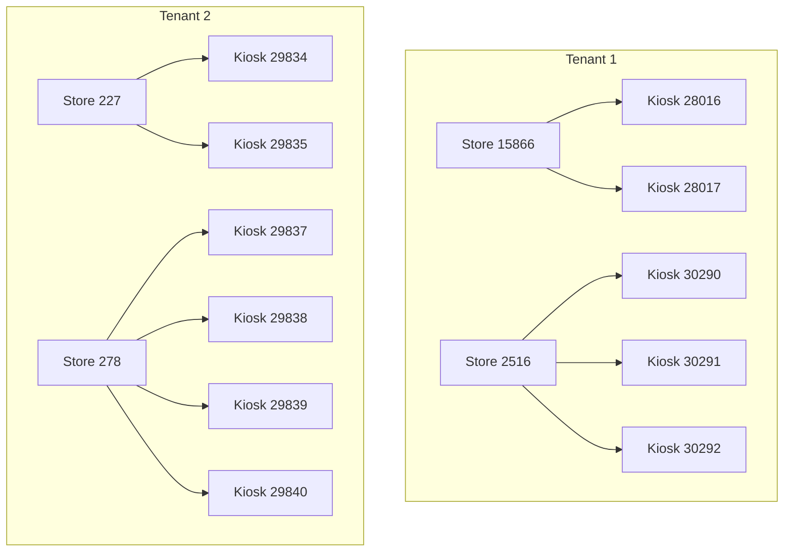
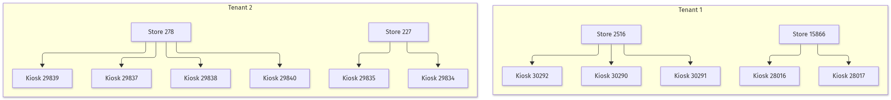
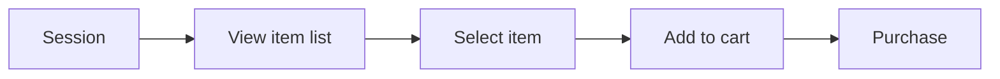
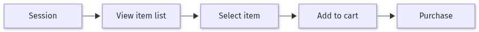
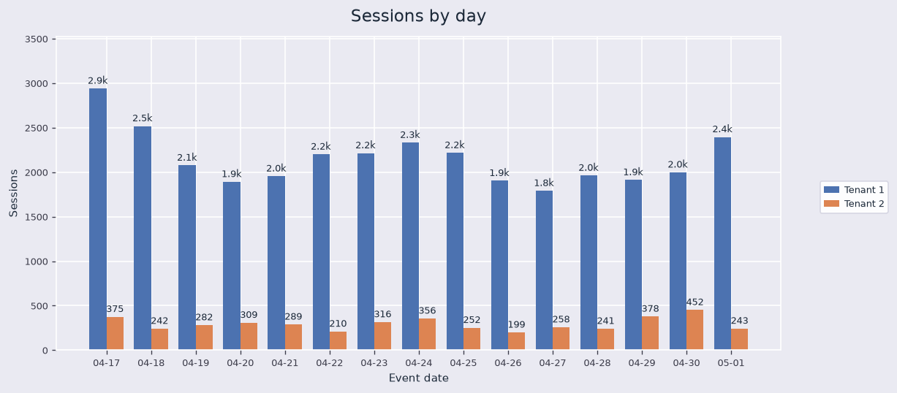
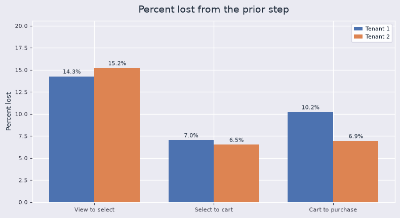

# Kiosk session analysis

## What this dataset is

This is a payment-operations log for self-serve kiosks. Tenants run stores. Stores run kiosks. A guest or customer walks up to a kiosk, starts a session, and moves through the order steps. Some stores take more steps (or more time) to finish than others. The start of the path is the session. The end of a completed path is a purchase.

## Journey

Tenant owns stores. Store owns kiosks. A session lives on one kiosk.

- **Tenant 1** has 29 stores, so the map only shows two.
- **Tenant 2** has both of its stores.





Intended path on the kiosk looks like this. The funnel still counts a step if that event shows up at least once, even if the guest skipped around.





## How the work was split

### Manual

- SQL setup, querying, and data discovery. I wrote and ran the DuckDB view, the discovery SQL files, and the grain and identity checks.
- Basic wrangling in the notebook. I shaped the session flags, daily aggregates, and the tables behind the charts.
- PowerPoint. I set up and curated the presentation myself.

### AI-assisted

- Charts. Mostly plotting and polishing labels, layout, and styling.
- README. Structure and polish on this file.
- Streamlit app. Frontend for the question box.

> The notebook that carries the analysis is [`notebooks/kiosk_sessions_operations_analysis.ipynb`](notebooks/kiosk_sessions_operations_analysis.ipynb). The SQL under `data/sql/` is what that notebook runs. Saved outputs were generated from the repo root.

## Four prompt areas

Written next to the numbers. Conversion is also in `data/sql/metric_layer.sql` (`conversion_by_tenant`). Denominator once: all sessions for that tenant (or all sessions at that store / kiosk).

### Conversion

Sessions with at least one purchase ÷ all sessions.

| Tenant | Sessions | Purchased | Purchase conversion |
| --- | ---: | ---: | ---: |
| Tenant 1 | 32,291 | 23,091 | 71.5% |
| Tenant 2 | 4,402 | 3,243 | 73.7% |

### Churn

Customer churn: refuse. No guest id, 15-day window.

> There is no guest ID or any identifier to track who is who and/or if they made a return to the same store/kiosk. So calculating traditional Churn rate with this dataset, is simply not feasible. I had to use the subsitute that best matched the dataset.

In-session substitute: carted and never purchased ÷ sessions that carted.

| Tenant | Reached cart | Cart, no purchase | Cart abandon rate |
| --- | ---: | ---: | ---: |
| Tenant 1 | 25,719 | 2,640 | 10.3% |
| Tenant 2 | 3,485 | 255 | 7.3% |

### Segmentation

| Tenant | Browse | Cart, no buy | Purchased |
| --- | ---: | ---: | ---: |
| Tenant 1 | 6,560 (20.3%) | 2,640 (8.2%) | 23,091 (71.5%) |
| Tenant 2 | 904 (20.5%) | 255 (5.8%) | 3,243 (73.7%) |

Act on store and kiosk (Tenant 1 store 11478 is at 58.8%). RFM and LTV need a guest id.

### Experiment

One test on the real gap: Tenant 1 cart → purchase (10.2% lost vs 6.9% for Tenant 2).

| Field | Choice |
| --- | --- |
| Hypothesis | Clearer checkout on Tenant 1 lifts cart→purchase toward Tenant 2 (~93%), without cutting revenue per buying session. |
| Unit | Session |
| Primary metric | Purchased ÷ carted |
| Guardrail | Revenue per buying session (Tenant 1 only) |
| Sample | ~7,800 carted sessions (~3,900/arm) for a ~3 pp lift; about 5 days of Tenant 1 cart traffic, run 1–2 weeks. |

No raw-row hypothesis.

## Discovery results

Pulled from `data/sql/discovery_query.sql`, `data/sql/discovery_grain.sql`, and `data/sql/discovery_session_identity.sql`. Revenue sums mix price units, so treat them as inventory, not a tenant ranking.

### What is in the file

| Rows | Tenants | Sessions | Event names | Stores | Kiosks | Items | Rows with revenue | Revenue sum |
| --- | ---: | ---: | ---: | ---: | ---: | ---: | ---: | ---: |
| 1,814,373 | 2 | 36,693 | 4 | 31 | 64 | 596 | 46,176 | 1,142,573.6 |

| Tenant | Rows | Sessions | Stores | Kiosks | Items | Rows with revenue | Revenue sum | First date | Last date |
| --- | ---: | ---: | ---: | ---: | ---: | ---: | ---: | --- | --- |
| Tenant 1 | 1,648,005 | 32,291 | 29 | 58 | 317 | 40,936 | 440,528.6 | 2026-04-17 | 2026-05-01 |
| Tenant 2 | 166,368 | 4,402 | 2 | 6 | 279 | 5,240 | 702,045.0 | 2026-04-17 | 2026-05-01 |

### Whether a session stays in one place

One row is one event. `session_id` + `event_index` repeats 46 times. No session jumps tenants, stores, or kiosks. Nine sessions touch two dates.

| Check | Sessions with more than one |
| --- | ---: |
| Tenants per session | 0 |
| Stores per session | 0 |
| Kiosks per session | 0 |
| Dates per session | 9 |

| Sessions | Sessions on more than one date | Longest span, in days |
| ---: | ---: | ---: |
| 36,693 | 9 | 1 |

No guest id in the file, so a session is a visit. It is not a customer coming back.

### Where sessions reach a purchase

Share of all sessions for that tenant. Count the step if the event appears at least once.

| Step | Tenant 1 sessions | Tenant 1 share | Tenant 2 sessions | Tenant 2 share |
| --- | ---: | ---: | ---: | ---: |
| Sessions | 32,291 | 100.0% | 4,402 | 100.0% |
| View item list | 32,267 | 99.9% | 4,397 | 99.9% |
| Select item | 27,664 | 85.7% | 3,728 | 84.7% |
| Add to cart | 25,719 | 79.6% | 3,485 | 79.2% |
| Purchase | 23,091 | 71.5% | 3,243 | 73.7% |

Percent lost from the prior step:

| Handoff | Tenant 1 | Tenant 2 |
| --- | ---: | ---: |
| View to select | 14.3% | 15.2% |
| Select to cart | 7.0% | 6.5% |
| Cart to purchase | 10.2% | 6.9% |

### Basket and price unit

| | Items per buying session | Median purchase item price |
| --- | ---: | ---: |
| Tenant 1 | 1.8 | 10.0 |
| Tenant 2 | 1.6 | 139.0 |

Baskets are close. Price units are not. That is why the revenue sums above are not a ranking.

### Stores

Purchase rate = sessions with a purchase / all sessions at that store. Tenant 1 ranges from 58.8% at store 11478 (2 kiosks) to 82.5% at store 15866 (2 kiosks). Tenant 2: store 227 at 78.6% (2 kiosks), store 278 at 71.5% (4 kiosks). Extra kiosks do not mean a higher rate. No kiosk sits in two stores.

## Visualization gallery

Charts from the notebook, saved as-is. Click an image for the full figure.

| | |
| :---: | :---: |
| Sessions by day. Tenant 1 is larger every date. | Session funnel. Labels are the true shares. Bands use an even taper. |
|  |  |
| Percent lost from the prior step. Biggest drop is view to select. | Items per buying session next to median item price. |
|  |  |
| Sessions and revenue, separate axis per tenant. | Purchase rate by store. |
|  |  |

Tables under each chart live in [the notebook](notebooks/kiosk_sessions_operations_analysis.ipynb).

## What you need

- Python 3.11 or newer
- Event file at `data/raw_data/dataset.csv.gz` (gzip of the source CSV; DuckDB reads it directly)
- Optional: [DuckDB CLI](https://duckdb.org/docs/installation/) if you want the SQL outside the notebook

About 1.8 million rows. First notebook run reads the whole file. Give it about a minute.

## Layout

| Path | What it is |
| --- | --- |
| `data/raw_data/dataset.csv.gz` | Source events. `data/sql/init_ddl.sql` points at this path. |
| `data/sql/init_ddl.sql` | Creates the `events` view. Other queries assume this already ran. |
| `data/sql/discovery_query.sql` | File inventory, then the same counts by tenant. |
| `data/sql/discovery_grain.sql` | Duplicate `session_id` + `event_index` pairs, plus whether one session crosses a tenant, store, kiosk, or date. |
| `data/sql/discovery_session_identity.sql` | How many sessions span more than one date, and the daily session / revenue table. |
| `data/sql/discovery_kiosk_stores.sql` | Kiosk list, store revenue, and a check that no kiosk sits in two stores. |
| `data/sql/discovery_events.sql` | One row per event (~1.8M). Notebook does not run this. |
| `notebooks/kiosk_sessions_operations_analysis.ipynb` | Discovery tables, journey maps, then charts. |
| `docs/gallery/` | Chart and journey images used above. |
| `data/sql/metric_layer.sql` | Metric tables the question app is allowed to query. |
| `app.py` | Question box. One question, one SELECT, SQL shown on the page. |
| `requirements.txt` | Python deps for the notebook and the question app. |

`events` has nine columns: `tenant`, `session_id`, `event_date`, `event_index`, `event_name`, `store_id_unified`, `kiosk_id_up`, `item_id_masked`, `item_revenue`. Chart event names: `view_item_list`, `select_item`, `add_to_cart`, `purchase`.

## Install

From the repo root in PowerShell:

```powershell
python -m venv .venv
.\.venv\Scripts\Activate.ps1
python -m pip install -r requirements.txt
```

On macOS or Linux: `source .venv/bin/activate`.

`requirements.txt` pulls DuckDB, pandas, matplotlib, ipykernel, and the question-app packages. DuckDB runs the SQL, pandas holds tables, matplotlib draws charts, ipykernel is the Jupyter kernel.

In Cursor or VS Code, point the notebook at the `.venv` interpreter.

## Run the notebook

Open `notebooks/kiosk_sessions_operations_analysis.ipynb` and Run All from the top.

The setup cell looks for `data/sql/init_ddl.sql` in the current directory, then the parent, chdirs to that root, opens an in-memory DuckDB connection, and runs `data/sql/init_ddl.sql`. After that, `events` points at `data/raw_data/dataset.csv.gz`.

Helpers used later:

- `sql_file(path)` reads a `.sql` file, strips `--` comments and `/* */` blocks, splits on `;`, returns one formatted table per statement.
- `load_daily()` builds sessions and item revenue by date and tenant.
- `load_session_flags()` builds one row per tenant + session with a flag per funnel step.

Restart the kernel after changing a SQL file or the setup cell. A later cell alone will fail until setup has run. Run All replaces the saved outputs.

## How to read the notebook

Sections follow the questions, not file order on disk.

1. **What is in the file.** `data/sql/discovery_query.sql`. Whole-file counts, then by tenant.
2. **Whether a session stays in one place.** `data/sql/discovery_grain.sql`. Duplicate pairs, then the cross-tenant / store / kiosk / date checks.
3. **A session is one visit.** `data/sql/discovery_session_identity.sql`. Date span, then the daily table.
4. **Stores, kiosks, and raw revenue.** `data/sql/discovery_kiosk_stores.sql`. One row per kiosk, one per store, then kiosks in more than one store. Empty third table means zero.
5. **Where a visit sits.** Tenant / store / kiosk sample.
6. **The path a session is built to follow.** Session → view → select → cart → purchase.
7. **The gap holds on every day.** Sessions by day. Tenant 1 is larger every date.
8. **Most visits reach a purchase.** Funnel per tenant. Labels are the true shares. With `PROPORTIONAL = False`, band widths are an even taper. Flip it to `True` if you want widths from the session counts.
9. **Where the sessions are lost.** Percent lost from the prior step.
10. **The basket is the same. The price unit is not.** Items per buying session next to median purchase price.
11. **Inside a tenant, busier days carry that tenant's revenue.** Sessions as bars, that tenant's item revenue as the line. Read each chart on its own revenue axis.
12. **Stores differ more than the tenants do.** Purchase rate by store, kiosk count on the label.

## Run the SQL in DuckDB

Start the CLI from the repo root. `data/sql/init_ddl.sql` loads `data/raw_data/dataset.csv.gz` with a relative path, so a different cwd will miss the file.

```powershell
cd /path/to/tillster-takehome-assignment
duckdb
```

Inside the prompt:

```sql
.read data/sql/init_ddl.sql
.read data/sql/discovery_query.sql
.read data/sql/discovery_grain.sql
.read data/sql/discovery_session_identity.sql
.read data/sql/discovery_kiosk_stores.sql
.quit
```

Run `init_ddl.sql` once per CLI session before the discovery files. Each `.read` runs every statement in that file.

Skip `data/sql/discovery_events.sql` for a normal pass. It returns ~1.8M rows and the notebook does not use it.

## Definitions the charts use

- A session is one `session_id` inside one tenant. Grain checks make that safe: no session crosses a tenant, store, or kiosk.
- A session reaches a funnel step when that `event_name` shows up at least once (`view_item_list`, `select_item`, `add_to_cart`, `purchase`). Presence, not `event_index` order.
- Store purchase rate = sessions with a purchase / all sessions at that store.
- Items per buying session = purchase rows in sessions that purchased.
- Daily revenue is `SUM(item_revenue)` for that tenant and date. Median price uses `item_revenue` on `purchase` rows only. Tenant 1 and Tenant 2 keep separate revenue axes because the units differ.

## Question app

`app.py` is a question box over the metric tables. It builds those tables from `data/sql/metric_layer.sql` after `data/sql/init_ddl.sql`, then drops the raw `events` view. A question becomes one `SELECT`. The page shows the SQL under the result.

Definitions match the notebook. Session = visit. Funnel step = that event name appeared. Item revenue stays inside one tenant. Churn, repeat visits, and LTV questions get refused because there is no guest id.

From the repo root, with the virtualenv active:

```powershell
copy .streamlit\secrets.toml.example .streamlit\secrets.toml
streamlit run app.py
```

Put an API key in `.streamlit/secrets.toml` (gitignored). First launch reads `data/raw_data/dataset.csv.gz` and builds the tables. Later questions reuse them until the process restarts.

## Local notes

If you keep a raw `data/raw_data/dataset.csv` for CLI experiments, leave it untracked. The committed source is `data/raw_data/dataset.csv.gz`.
